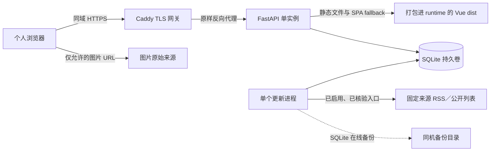

# 标题版美妆情报台 — 后端技术方案设计

本文设计单台云服务器上的个人标题阅读应用。真实来源只能在使用条件确认且运行验证通过后启用；未启用的目标来源不能伪装成已接入。前端视觉与交互的唯一详细方案见 [frontend.md](<frontend.md>)。

## 第一部分：架构决策

### Decision Ledger

| ID | Decision | Source | Blocking | Status | Evidence / explicit confirmation |
| --- | --- | --- | --- | --- | --- |
| D-002 | 应用部署在常开的云服务器 | 本会话 D-002 | yes | user-confirmed | D-002：用户在 `D-002-deployment` 选择常开云服务器，通过网址访问。 |
| D-003 | 单人密码登录，不开放注册 | 本会话 D-003 | yes | user-confirmed | D-003：用户在 `D-003-access-control` 选择单人密码登录，不开放注册。 |
| D-004 | Python + FastAPI | 本会话 D-004 | yes | user-confirmed | D-004：用户在 `D-004-backend-stack` 选择 Python + FastAPI。 |
| D-006 | SQLite 单机持久化 | 本会话 D-006 | yes | user-confirmed | D-006：用户在 `D-006-storage` 选择 SQLite，限制为单机写入。 |
| D-007 | 独立后台进程，数据库持有任务 | 本会话 D-007 | yes | user-confirmed | D-007：用户在 `D-007-background-jobs` 选择独立后台进程和数据库任务记录。 |
| D-008 | 不接模型、不生成摘要、不采集正文 | 本会话 D-008、[PRD 1.2](<../prd.md>) | yes | user-confirmed | D-008：用户在 `D-008-summary-service` 明确说“这个版本不配置外部模型，不需要中文摘要，只抓取内容标题”。 |
| D-009 | 标题加来源、链接、可得日期与允许的图片外链 | 本会话 D-009 | yes | user-confirmed | D-009：用户在 `D-009-title-capture-boundary` 选择标题及必要元信息。 |
| D-010 | 只按相同原文链接去重，不跨媒体归并 | 本会话 D-010 | yes | user-confirmed | D-010：用户在 `D-010-title-deduplication` 选择只去除相同原文链接。 |
| D-011 | 根据来源栏目和明确标题规则分类 | 本会话 D-011 | yes | user-confirmed | D-011：用户在 `D-011-title-classification` 选择来源栏目与标题规则，信息不足不补造。 |
| D-012 | 官方 RSS／公开接口优先，允许的公开列表补充 | 本会话 D-012 | yes | user-confirmed | D-012：用户在 `D-012-source-intake-strategy` 选择 RSS／接口优先并允许公开列表补充。 |
| D-013 | 五站为首批目标，PR TIMES 两入口同站去重 | 本会话 D-013 | yes | user-confirmed | D-013：用户在 `D-013-initial-sources` 指定 PR TIMES RSS／Beauty、HAPPI RSS、青眼、Premium Beauty News、COSIN Korea。 |
| D-014 | 逐站核验、分站启用、受限不绕过 | 本会话 D-014 | yes | user-confirmed | D-014：用户在 `D-014-source-activation-policy` 选择分站启用，未通过明确标注。 |
| D-015 | Linux + Docker Compose | 本会话 D-015 | yes | user-confirmed | D-015：用户在 `D-015-deployment-packaging` 选择 Linux + Docker Compose。 |
| D-016 | 当天错过或未成功的定时任务恢复后补跑一次 | 本会话 D-016 | yes | user-confirmed | D-016：用户在 `D-016-missed-schedule` 选择当天补执行一次，不回放多天。 |
| D-017 | 服务器管理会话，退出立即失效 | 本会话 D-017 | yes | user-confirmed | D-017：用户在 `D-017-login-session` 选择服务器管理会话并立即注销。 |
| D-018 | 页面与接口同一 HTTPS 域名 | 本会话 D-018 | yes | user-confirmed | D-018：用户在 `D-018-same-origin` 选择同一个 HTTPS 域名。 |
| D-019 | 每日本机 SQLite 备份，保留七份 | 本会话 D-019 | yes | user-confirmed | D-019：用户在 `D-019-backup-policy` 选择每天本机自动备份及最近七份。 |
| D-021 | Caddy 同域入口 | 本会话 D-021 | yes | user-confirmed | D-021：用户选择 Caddy 提供同域 HTTPS；D-038 进一步把静态文件 owner 收口到 FastAPI，Caddy 只做代理与 TLS。 |
| D-022 | 七类必要数据、SQLAlchemy 与 Alembic | 本会话 D-022 | yes | user-confirmed | D-022：用户在 `D-022-data-model` 确认七类数据、约束及 SQLAlchemy／Alembic 方案。 |
| D-023 | 重试只处理上次失败入口 | 本会话 D-023 | yes | user-confirmed | D-023：用户在 `D-023-retry-scope` 选择仅重试失败入口，刷新更新全部已启用入口。 |
| D-024 | 最小 REST／JSON 契约及服务端分页 | 本会话 D-024 | yes | user-confirmed | D-024：用户在 `D-024-api-contract` 确认登录、列表、收藏、来源状态与任务接口组。 |
| D-026 | 安全基线、24 小时会话及真实验收 | 本会话 D-026 | yes | user-confirmed | D-026：用户在 `D-026-security-validation` 确认安全规则、24 小时期限和验证范围。 |
| D-027 | 去掉首尾空格和定位标记后比较完整链接 | 本会话 D-027 | yes | user-confirmed | D-027：用户在 `D-027-url-identity` 选择去空格与定位标记，保留全部查询参数。 |
| D-028 | 至少一个来源真实可用才算正式交付 | 本会话 D-028 | yes | user-confirmed | D-028：用户在 `D-028-live-source-acceptance` 选择至少一个来源核验并跑通真实更新。 |
| D-029 | 前后端各一份 small form 与直接索引 | 本会话 D-029 | yes | user-confirmed | D-029：用户在 `D-029-design-form` 确认 `00-index.md`、`backend.md` 和 `frontend.md`，不转换或删除。 |
| D-030 | 中断保留成功结果，只补未完成或失败项 | 本会话 D-030 | yes | user-confirmed | D-030：用户在 `D-030-interrupted-update` 确认当天自动补跑最多一次，之后可手动重试。 |
| D-031 | 收藏按收藏时间倒序，首页仍按报道日期倒序 | 本会话收藏排序确认及本轮修订摘要 | yes | user-confirmed | D-031：用户在 `favorites-order-resolution` 选择“按收藏时间从新到旧”，本轮 D-031～D-037 摘要再次列明首页排序不变。 |
| D-032 | 首次登录单独检查同源和限流，不要求已有会话 CSRF | 本会话 D-032 | yes | user-confirmed | D-032：用户在 `D-032-login-csrf` 选择“登录单独校验，其余写操作保持保护”。 |
| D-033 | 没有当天定时记录时，补跑当前已核验且启用的入口 | 本会话 D-033 | yes | user-confirmed | D-033：用户在 `D-033-missed-schedule-scope` 选择“补跑当前已启用入口”，保留当天最多一次与不追补历史的边界。 |
| D-034 | 重启先结算旧运行任务、释放活动占用，再补未完成项 | 本会话 D-034 | yes | user-confirmed | D-034：用户在 `D-034-interrupted-job-settlement` 选择“先结算旧任务，再补未完成项”，成功结果保留。 |
| D-035 | 来源各入口分别保存核验状态、原因及依据 | 本会话 D-035 | yes | user-confirmed | D-035：用户在 `D-035-source-entry-evidence` 选择“每个入口分别记录”；网站层只作汇总，未核验入口禁用。 |
| D-036 | 列表每条直接返回服务端收藏状态，与详情及写结果一致 | 本会话 D-036 | yes | user-confirmed | D-036：用户在 `remaining-design-recommendations` 勾选“确认 D-036：列表直接返回收藏状态”。 |
| D-037 | 保持简单页码分页，接受后台更新时跨页结果位移 | 本会话 D-037 | yes | user-confirmed | D-037：用户在 `remaining-design-recommendations` 勾选“确认 D-037：采用简单页码分页”，不增加快照或游标。 |
| D-038 | 单根 Dockerfile 构建前后端，FastAPI 提供静态文件 | 本会话最新部署要求 | yes | user-confirmed | 用户明确要求一个代码仓库只保留一个 Dockerfile 和一个 docker-compose file，部署时把前端打包进后端静态目录。 |

跨端视觉、Vue 技术及页面决策 D-001、D-005、D-020、D-025 的唯一所有者是 [前端 Decision Ledger](<frontend.md>)，此处不复制台账行。

### 决策 1：单机、双进程与同域入口

- **ID**：`D-002`、`D-004`、`D-006`、`D-007`、`D-015`、`D-018`、`D-021`、`D-038`。
- **选择**：一台常开 Linux 云主机，唯一根 Dockerfile 编译 Vue 并复制到 FastAPI 静态目录；Compose 管理同一 runtime 镜像的 API/worker/migrate 与 gateway target。FastAPI 同域提供 SPA 和 API，Caddy 只负责 HTTPS、安全头和原样反向代理。
- **理由与取舍**：与应用内定时线程相比，独立进程能在长采集期间保持请求可响应；与 Redis 队列或多服务器方案相比，不引入当前单人串行需求以外的服务。一个后台进程是当前上限，不靠未来扩展理由增加队列。
- **方案比较**：Caddy 与 Nginx＋证书工具均能满足同域入口；用户按 D-021 选择 Caddy，减少证书管理环节。真实 HTTPS 仍依赖可用域名、DNS 和开放端口。
- **状态**：上述 ID 均为 `user-confirmed`；来源为本会话各 ID 的明确选择。

### 决策 2：标题导航而非内容分析

- **ID**：`D-008`～`D-014`、`D-027`、`D-028`。
- **选择**：只提取标题与必要元信息；链接去重、明确规则分类；五个目标来源按条件分站启用，至少一个来源真实可用后才能宣称交付完成。
- **理由与边界**：用户主动移除了正文、摘要、模型和事件归并；不同媒体的相同事件可以重复。RSS 整体响应可能包含正文片段，解析器只读取允许的标题、链接、日期等元信息，不提取、记录或保存正文，不额外请求文章详情。
- **状态**：上述 ID 均为 `user-confirmed`；来源为对应设计问答及[标题版提案](<../proposal.md>)。

### 决策 3：单人会话、任务恢复与数据保障

- **ID**：`D-003`、`D-016`、`D-017`、`D-019`、`D-022`～`D-024`、`D-026`、`D-030`。
- **选择**：单人服务端会话、七类必要持久数据、REST／JSON、串行更新、失败入口重试和每日本机备份。
- **理由与边界**：任务需要跨重启追踪且网页不能等待采集完成；数据库内记录任务是当前需要。自动补跑有次数上限，失败后可手动重试。本机备份不覆盖整机丢失。
- **状态**：上述 ID 均为 `user-confirmed`；来源为对应设计问答。

### 决策 4：规划前的定点设计补齐

- **ID**：`D-031`～`D-037`。
- **选择**：区分首页与收藏排序；首次登录不依赖已有会话；补齐定时完全错过和中断结算规则；逐入口核验；列表直接携带收藏状态；采用非快照的简单页码分页。
- **理由与范围**：修正同一份设计中会造成首登失败、更新卡住、许可状态混淆或前后端结果不一致的具体缺口，不重做已确认架构。分页不引入额外快照存储，代价是并发更新时跨页结果可能位移。
- **来源／状态**：上述 ID 均有本会话对应选择；本轮单独授权定点修改后端设计并刷新评审。它不是普通计划转入 FeaturePilot，也不是任务或实现授权。

### Pre-write Confirmation Evidence

- Covered IDs: `D-002`, `D-003`, `D-004`, `D-006`, `D-007`, `D-008`, `D-009`, `D-010`, `D-011`, `D-012`, `D-013`, `D-014`, `D-015`, `D-016`, `D-017`, `D-018`, `D-019`, `D-021`, `D-022`, `D-023`, `D-024`, `D-026`, `D-027`, `D-028`, `D-029`, `D-030`, `D-031`, `D-032`, `D-033`, `D-034`, `D-035`, `D-036`, `D-037`
- Outstanding blocking decisions: `none`
- Explicit user authorization to write: 初次创建沿用 `design-prewrite-authorization` 对 D-001～D-030、两端 small form 与直接索引的授权；`design-targeted-revision-write-authorization` 批准 D-031～D-037 的后端定点修订。提交前曾因字节数误判提出 split；在纠正为约22,000 Unicode字符、未超限后，用户在 `confirm-backend-design-form-after-correction` 明确选择“恢复 small（Recommended）”。最终 canonical 入口为 `design/backend.md`，内容和决策语义不变。

## 第二部分：技术方案详述

### 设计范围适用性

| 评审范围 | 要求 | Canonical owner section | 证据或不适用理由 |
| --- | --- | --- | --- |
| 架构主线 | 必填 | `#架构主线` | D-002、D-004、D-006、D-007、D-015、D-018、D-021。 |
| 核心对象与职责 | 必填 | `#核心对象与职责` | 已确认提案的来源、标题、收藏和更新闭环。 |
| 数据模型 | 适用 | `#数据模型` | D-006、D-022，七类持久数据。 |
| 状态、并发与执行流程 | 适用 | `#状态并发与执行流程` | D-007、D-016、D-023、D-030。 |
| 接口、权限与兼容边界 | 适用 | `#接口权限与兼容边界` | D-003、D-017、D-024、D-026。 |
| 前端方案 | 条件适用 | [frontend.md](<frontend.md>) | 页面、视觉与前端状态由前端文件唯一负责。 |
| 风险、迁移、发布、回滚与监控 | 必填 | `#风险迁移发布回滚与监控` | 真实来源、SQLite 与备份风险。 |
| 验证方案 | 必填 | `#验证方案` | 标题版 PRD 第五章和 D-026、D-028。 |

### 架构主线

浏览器的图片请求直接发往图片来源；本站不下载或代理图片。浏览器与服务之间使用同源 HTTPS；只有通过认证的浏览器可读写业务数据。FastAPI 提交更新任务后立即返回任务标识，独立进程串行处理并写入结果；页面通过任务状态接口查看结果。

项目无既有正式后端、数据模型或已登记技术栈，证据为[提案 Impact 和 P-012](<../proposal.md>)、本次仓库与配置检查；旧原型只作交互参考，不作为生产依赖。没有 Redis、分布式队列、搜索服务或模型服务。

### 核心对象与职责

| 对象/模块 | 职责 | 不负责 | 协作对象 | 证据 |
| --- | --- | --- | --- | --- |
| 来源注册与核验 | 保存五站状态、入口及使用条件证据；仅启用核验通过项 | 不从页面提供来源编辑，不把可访问当授权 | 入口适配器、任务 | D-013、D-014、D-028 |
| 入口适配器 | 读取 RSS 或允许的公开列表；提取标题、链接、日期及允许的图片地址 | 不请求文章详情，不提取正文、摘要或运行页面脚本 | 固定来源、分类规则 | D-008、D-009、D-012 |
| 条目与分类 | 规范比较链接、写入标题和可得信息，依据栏目／标题明确规则分类 | 不做语义归并、模型调用或市场推断 | 入口适配器、收藏 | D-010、D-011、D-027 |
| 更新任务 | 单进程消费任务、逐入口记录结果与中断恢复 | 不新增 Redis，不阻断已有阅读 | 数据库、接口 | D-007、D-023、D-030 |
| 认证与会话 | 验证单人密码、签发和撤销会话，保护业务接口 | 不开放注册、多人或权限后台 | API、Session | D-003、D-017、D-026 |
| 收藏 | 维护单人到资讯条目的幂等引用 | 不复制标题快照、正文或图片 | 条目、API | D-022、D-024；PRD 3.4 |

### 后端模块设计

后端采用分层单体，不机械复制 MVC：`core` 持配置和跨层异常，`domain` 持纯标题／分类／来源身份规则，`application` 持查询、事务、认证、许可、任务和调度用例，`infrastructure` 持 SQLAlchemy/SQLite、本地配置、feed 解析与安全 HTTP 适配器，`presentation/http` 持 FastAPI 路由和请求适配，`runtime` 持独立 worker。根 `app.main`、`app.worker`、`app.backup` 只是稳定运行入口，内部实现不得反向依赖它们。

依赖只向内：domain 不依赖其它业务层或框架；infrastructure 不依赖 application/presentation/runtime；application 不依赖 FastAPI/Starlette/presentation/runtime。当前只有 SQLite 一个持久化适配器，不建立假想 repository/DI container 或一函数一个 service；路由薄是适配器角色，而不是缺少业务层。架构守卫测试持续验证依赖方向。

适配器仅针对实际有差异的 RSS、公开列表输入实现；不建立动态插件市场或来源编辑界面。五站是目标清单，不等于每站都必须自动启用；PBN 的建库限制及其他未明确的使用条件必须在启用前核验。

| 目标来源／候选入口 | 本轮只读核验结果 | 启用前仍需确认 |
| --- | --- | --- |
| [PR TIMES 全站 RSS](https://prtimes.jp/index.rdf)、[Beauty 列表](https://prtimes.jp/beauty/) | RSS 在核验时返回标题、链接与日期；它是多行业滚动窗口，不能保证完整美妆覆盖。Beauty 页面可见标题和日期，但需要验证实际列表结构与更新顺序。 | 对照 [使用条款](https://prtimes.jp/main/html/kiyaku)，确认个人应用的自动读取、标题保存及可选图片展示范围；RSS 与列表同站按原文链接去重。 |
| [HAPPI RSS](https://www.happi.com/feed/) | 网页抓取工具曾返回标题、日期与分类，样本包含正文模块；普通 Node 请求其首页曾返回 403，不能推定服务器可稳定访问。 | 在目标服务器核验 RSS 访问、更新频率与 [使用条款](https://www.happi.com/terms-conditions/)；不提取或保存正文。 |
| [青眼首页](https://www.iqingyan.cn/) | 页面可见标题及日期，但核验到的是热度排行，不能当成已验证的最新资讯流。 | 确认可持续入口、自动读取与标题保存的使用条件；未确认则不启用。 |
| [Premium Beauty News](https://www.premiumbeautynews.com/en/) | 站点可访问；[法律声明](https://www.premiumbeautynews.com/en/legal-notice,85)限制将网站信息用于建立数据库。 | 不默认启用；须取得适用于本用途的明确许可并验证具体入口。 |
| [COSIN Korea](https://cosinkorea.com/) | 首页可读标题，页面发现 RSS 入口；本轮未验证该入口运行，站点页脚禁止未经授权复制和分发。 | 核验入口、标题保存与图片展示条件；未确认则不启用。 |

这些均为目标来源和有时间限制的核验记录，不是最终授权、稳定性或覆盖承诺。验收必须在目标云服务器重新验证；某站点不满足条件时保留未启用状态，不以网络可访问代替许可。

### 数据模型

采用 SQLAlchemy 与 Alembic；下表是唯一字段载体，未同时给出模型代码。数据库时间统一存 UTC；调度按 `Asia/Shanghai` 计算，报道日期保留来源明示的日期语义，不用采集时间补造。数据库与备份目录均为持久卷，不保存正文或图片字节。

#### 完整字段定义

| 表／字段 | 类型 | 必填/空值 | 默认值 | 关联/约束 | 证据 |
| --- | --- | --- | --- | --- | --- |
| `sources.id`, `key`, `name` | integer PK；text；text | 均必填 | 无 | `key` 唯一；目标站点身份稳定 | D-013、D-022 |
| `sources.language`, `verification_status`, `reason` | text；text；text | 语言和原因可空；状态必填 | 状态 `pending` | 网站级状态与原因只汇总入口结果，不能替代入口许可；显示时说明全部或部分入口可用 | D-014、D-035 |
| `source_entries.id`, `source_id`, `url`, `kind` | integer PK；integer FK；text；text | 均必填 | 无 | 引用 `sources`；类型为 RSS 或公开列表；入口 URL 同一来源内唯一 | D-012、D-013、D-022 |
| `source_entries.verification_status`, `verification_reason`, `verification_reference` | text；text；text | 状态必填；原因和依据在待核验时可空，核验为允许或受限时必填 | 状态 `pending`；其余空 | 状态为 `pending`、`allowed` 或 `restricted`；分别保存本入口的条件、结论及依据引用，不以最后访问错误代替许可 | D-035 |
| `source_entries.enabled`, `last_success_at`, `last_error` | boolean；datetime；text | 状态必填；时间和错误可空 | 禁用；其余空 | 仅本入口核验为允许、依据完整且运行验证成功后可启用；网站汇总为允许也不能启用待核验入口 | D-014、D-028、D-035 |
| `articles.id`, `source_id`, `first_entry_id` | integer PK；integer FK；integer FK | 均必填 | 无 | 第一次有效来源归属稳定；不同入口指向相同原文时不创建重复条目 | D-010、D-022 |
| `articles.original_url`, `dedup_url`, `title`, `search_text` | text | 均必填且非空 | 无 | `dedup_url` 唯一；`original_url` 用于打开原文；`search_text` 为标题和来源的检索文本，不含正文 | D-009、D-027 |
| `articles.reported_date`, `category_codes`, `region`, `product_type` | date；JSON 文本数组；text；text | 日期、地区和品类可空；分类数组必填 | 分类空数组，其余空 | 分类可多选；空数组为未分类；日期仅来自来源，未知不补造 | D-011、PRD 3.2 |
| `articles.image_url`, `image_credit`, `updated_at` | text；text；datetime | 图片及署名可空；时间必填 | 图片空；更新时间由写入决定 | 图片 URL 仅在允许展示且与条目对应时保存；不存图片字节 | D-009、D-014 |
| `bookmarks.article_id`, `created_at` | integer FK；datetime | 均必填 | 时间由写入决定 | `article_id` 为唯一键；只引用条目，取消不删除条目 | D-022、D-024 |
| `update_jobs.id`, `trigger`, `state`, `created_at`, `started_at`, `finished_at` | integer PK；text；text；三个 datetime | id、触发、状态、创建必填；开始/结束可空 | 状态 `pending`；创建时间由写入决定 | 触发为定时、补跑、手动、重试；状态为 `pending`、`running`、`succeeded`、`partial`、`failed` 或 `interrupted`；中断结算必须填写结束时间 | D-007、D-016、D-030、D-034 |
| `update_jobs.schedule_date`, `active_key` | date；integer | 定时及补跑任务的日期必填，手动与重试可空；活动键必填且恒为 1 | 活动键 1 | 日期以北京时间表示；活动任务使用部分唯一索引；每日定时与补跑分别按日期建部分唯一索引，补跑任务本身就是已用次数的持久证据 | D-016、D-030 |
| `entry_results.id`, `job_id`, `entry_id`, `state` | integer PK；integer FK；integer FK；text | 均必填 | `pending` | 每任务与入口组合唯一，分别记录待执行、运行、成功、失败或中断 | D-023、D-030 |
| `entry_results.count_added`, `count_updated`, `error`, `finished_at` | integer；integer；text；datetime | 计数必填；错误和完成时间可空 | 计数 0；其余空 | 只存可展示结果；不得保存原始响应、正文或凭据 | D-008、D-023、D-026 |
| `sessions.id`, `token_digest`, `expires_at`, `created_at` | integer PK；text；datetime；datetime | 均必填 | 时间由签发决定 | 随机令牌只在浏览器 Cookie；数据库只保存令牌摘要；CSRF 标记由会话令牌和服务端密钥派生，不存明文；会话 24 小时到期，退出删除记录 | D-017、D-026 |

#### 字段与存储取舍

| 字段/数据 | 候选表示 | 最终选择 | 数据体积与读取方式 | 选择理由 | 证据 |
| --- | --- | --- | --- | --- | --- |
| 标题、URL、错误说明 | 固定长度字段／文本 | SQLite `TEXT` | 单条按列表与详情读取；响应和字段长度在采集边界限制 | 中文、日文、英文长度不同；不截断以免破坏 URL | D-009、D-026 |
| 分类 | 关联表／JSON 数组 | 条目内受控 JSON 数组 | 七类固定值，筛选通过 SQLite JSON 查询；空数组为未分类 | 维持七张表且允许一条多类；当前单人规模优先简单，性能以实测决定 | D-011、D-022 |
| 报道日期 | 采集时间／来源日期 | 可空 `DATE` | 按日期排序与筛选，空值排最后 | 不伪造来源未披露的日期 | [PRD 3.2](<../prd.md>) |
| 图片 | 平台存储／来源 URL | 可空 URL 与署名 | 浏览器直连已允许来源 | 不下载、代理或转存 | D-009；[PRD 3.2](<../prd.md>) |
| 来源响应 | 原文副本／必要字段 | 只保存必要字段 | 原始响应只在本轮解析中短暂经过内存；日志不写正文 | RSS 可能含正文，既定范围不提取或存储 | D-008、D-009 |

#### 逻辑模型与物理存储

| 逻辑对象 | ORM/Schema 对象 | 物理表或存储 | 主键与关联键 | 证据 |
| --- | --- | --- | --- | --- |
| 目标来源 | `Source` | `sources` | `id`；被入口和条目引用 | D-013、D-022 |
| 来源入口 | `SourceEntry` | `source_entries` | `id`；`source_id → sources.id` | D-012、D-022 |
| 标题资讯 | `Article` | `articles` | `id`；来源和首次入口外键；`dedup_url` 唯一 | D-010、D-027 |
| 个人收藏 | `Bookmark` | `bookmarks` | `article_id → articles.id` | D-022、D-024 |
| 更新任务 | `UpdateJob` | `update_jobs` | `id`；来源结果引用任务 | D-007、D-030 |
| 单入口结果 | `EntryResult` | `entry_results` | `id`；`job_id` 与 `entry_id` 外键 | D-023 |
| 登录会话 | `Session` | `sessions` | `id`；令牌摘要唯一 | D-017、D-026 |

#### 继承字段与重复存储结论

项目没有现有模型基类、manager 或 mixin；模型不引入多表继承。只在各表声明实际需要的键和时间，不复制正文、图片或模型结果。收藏不重复存标题；同一个来源的两个入口归属于同一来源。

#### 索引、约束与软删除

- `articles.dedup_url` 使用二进制精确唯一索引；规则仅裁去首尾空格与 `#` 片段，不删除查询参数、不更改路径或参数顺序。不同媒体链接不合并。
- `bookmarks.article_id` 唯一；取消只删除关系，不删除资讯。`entry_results(job_id, entry_id)` 与 `source_entries(source_id, url)` 唯一。
- `update_jobs.active_key` 约束恒为 1，按 `state IN ('pending','running')` 建 SQLite 部分唯一索引，结合事务保证并发触发返回同一活动任务。定时和补跑任务的 `schedule_date` 不可空，并分别对 `trigger='schedule'` 与 `trigger='catchup'` 建按日期的部分唯一索引；补跑任务创建时即占用当天次数，进程反复重启也不会创建第二次自动补跑。
- 本期无软删除、内容版本历史或审核状态。来源或原文不可用不删除条目；若未来引入软删除，须重新确认唯一约束及收藏语义。

#### 查询模式与索引映射

| 查询模式 | 过滤/排序/关联字段 | 对应索引或访问路径 | 选择理由 | 证据 |
| --- | --- | --- | --- | --- |
| 最新标题列表 | `reported_date DESC, id DESC` | `(reported_date DESC, id DESC)` | 已知日期倒序，SQLite 降序时空日期置后；数据不变时页码结果确定，不提供跨更新快照 | PRD 3.2；D-024、D-037 |
| 分类、地区或品类筛选 | 分类数组、地区、品类及日期 | 日期索引先限制顺序，SQLite `json_each`／字段过滤 | 分类可能多值，单人规模先不加关联表或搜索服务；以实测评估 | D-011、D-022 |
| 标题关键词 | `search_text` | 对 `search_text` 做规范化包含匹配并分页 | 多语言子串不能承诺普通 B-tree 加速；当前不伪称建立全文索引 | D-009、D-024 |
| 收藏列表 | `bookmarks.article_id → articles.id`；`bookmarks.created_at DESC, article_id DESC` | 收藏唯一键及 `(created_at DESC, article_id DESC)` 索引 | 最近收藏优先，同时间按条目 ID 排序；与首页报道日期排序明确区分 | D-022、D-024、D-031 |
| 更新和去重 | `dedup_url`、活动状态、`job_id/entry_id` | 上述唯一索引和结果组合键 | 防重复，按任务定位失败入口 | D-023、D-027 |
| 会话校验 | `token_digest`、`expires_at` | 唯一摘要索引，过期会话按过期时间清理 | 每次受保护请求可定位并撤销服务端会话 | D-017、D-026 |

分类或关键词查询超过实测可接受响应时，触发对受控分类索引或专门搜索能力的评估；在当前单机个人范围内不预建这些组件。此简化不允许忽略现有筛选或分页结果正确性。

#### 生命周期数据归属

许可判定、原因和依据分别归各 `source_entries`，`sources` 只汇总网站状态；网络访问失败归入口运行结果，不能改写许可结论。单轮进度和错误归 `update_jobs`／`entry_results`；资讯最新元信息归 `articles`；收藏归 `bookmarks`；会话有效期归 `sessions`。不建立发布审核、软删除或历史正文生命周期。

#### Migration 影响

首版由 Alembic 建立七张表、约束和索引；未有旧业务库或原型数据迁移。发布前确认备份可恢复，再执行迁移；回滚时恢复对应备份会丢失备份后的写入，必须先告知并确认。无物理收益的模型元数据变化不单独制造迁移。

#### 技术栈专项结论

SQLAlchemy 显式映射一模型一表，SQLite 开启外键约束；文本与 JSON 的合法性在边界验证，数据库约束兜底。按已确认的单机、单后台进程运行，不假设 Django 基类或迁移规则。写入事务保持短小；数据库锁争用、磁盘满和备份失败须可见并可恢复。

### 状态、并发与执行流程

1. 单后台进程以北京时间判断 07:30，只有来源和入口已核验、已启用时才纳入执行。手动刷新选择全部已启用入口；重试只选择上次失败或中断的入口。未启用项显示原因，不被默认为成功或失败采集。
2. API 在短事务内检查并创建任务及入口结果；部分唯一索引防止并发重复任务。已有活动任务时返回该任务的标识和状态，不重复入队。
3. 后台以原子事务认领待处理任务，逐入口读取，成功入口的条目与结果及时提交。单条记录缺少标题或原文链接时跳过并记录可说明原因；其它来源成功结果保留。
4. 链接比较先去首尾空格、去 `#` 后片段，其他字符和全部查询参数原样保留，再由数据库唯一约束完成幂等更新；同链接更新标题或可得字段时不删除已有收藏。未知或新响应未提供字段不覆盖原有可靠值。
5. 入口全部成功为 `succeeded`；有成功也有失败为 `partial`；没有成功为 `failed`。各入口均成功但没有新增或更新时显示“本次无新增”，不等同空库。PR TIMES 全站 RSS 是多行业滚动流；没有明确分类依据的条目按 D-011 保留在“全部／未分类”，因此可能混入非美妆标题，不能声称该流天然只包含美妆内容。
6. 单后台进程重启时，先在短事务内结算旧 `running` 任务：任务进入终态 `interrupted`，记录 `finished_at`；只把仍未完成的入口结果标为中断，已成功或失败的结果不覆盖，已提交条目保留。先释放旧任务的活动唯一约束，再检查补跑或接受新的手动任务。正常排队的 `pending` 任务不因重启直接标为中断；同一时刻仍只允许一个活动任务。
7. 当天 07:30 后且当天定时任务未成功时，最多进行一次持久记录的自动补跑。若没有当天定时任务或入口结果，补跑候选为当前全部已核验且启用的入口；若已有记录，只补失败或未完成项，不重新处理已成功项。执行前重新校验各入口条件，未核验或已禁用的入口不访问。更早的日程不回放；补跑耗尽后仍失败或再次中断，显示原因，等待手动重试或下次定时更新。
8. 当天有手动任务执行时不并发启动定时任务；活动任务结束后再检查当天是否需要补跑。补跑创建与每日次数记录在同一事务中完成，受按日期的部分唯一索引约束；并发用户请求返回已有活动任务，进程重启不增加补跑次数。

来源响应采用受限超时、大小与次数，具体默认值作为实现配置并在验证中记录；解析错误、来源不可用或策略限制分别显示可说明原因。不得把来源返回零条无异常数据自动解释为失败，也不得把截断或解析异常假报为成功。

### 接口、权限与兼容边界

接口同源 `/api`，请求与响应均为 JSON；错误采用稳定的 `code`、可显示的 `message` 和请求标识，不返回密钥、原始正文或堆栈。登录入口是建立会话前的特例：不要求已有会话或会话绑定的 CSRF 标记，仍校验同源 Origin、JSON 请求格式并限流。其余业务接口均要求有效会话，写请求另校验同源和会话绑定的 CSRF 标记。

| 方法与路径 | 请求 | 成功响应与行为 | 错误与权限 |
| --- | --- | --- | --- |
| `POST /api/auth/login` | JSON 密码请求及本站 Origin；不要求已有会话标记 | 同源、格式、限流和密码校验通过后，签发 24 小时服务端会话 Cookie，返回会话信息与 CSRF 标记 | 非本站请求拒绝；密码错误统一提示并限制尝试，不暴露摘要或密钥 |
| `GET /api/auth/session` | 无 | 返回登录状态、到期时间和当前会话 CSRF 标记 | 未认证返回 401 |
| `POST /api/auth/logout` | CSRF 标记 | 删除当前会话并清理 Cookie，重复退出安全 | 无有效会话返回 401；CSRF／来源校验失败返回 403 |
| `GET /api/articles` | `q`、`category`、`region`、`product_type`、`date_from`、`date_to`、`page`、`page_size` | 返回条目数组、总数及页码信息；每条含布尔值 `bookmarked`；按报道日期和 ID 倒序，未知日期排后 | 非法筛选返回 400；分页设安全上限；未认证 401 |
| `GET /api/articles/{id}` | 条目 ID | 返回当前标题、来源、日期、已知分类、允许的图片 URL、原文 URL 与布尔值 `bookmarked` | 不存在 404；未认证 401 |
| `GET /api/filters` | 无 | 返回可用分类、地区、品类选项及未分类／未披露状态 | 未认证 401；不为缺值虚构选项 |
| `GET /api/bookmarks` | 与首页一致的筛选和页码参数；排序独立 | 返回收藏条目、总数及分页信息；每条 `bookmarked=true`；按收藏时间和条目 ID 倒序 | 未认证 401 |
| `PUT /api/bookmarks/{article_id}` | CSRF 标记 | 幂等设为已收藏，返回 `{article_id, bookmarked: true}`；不以重复收藏重置收藏时间 | 条目不存在 404；未认证 401，校验失败 403 |
| `DELETE /api/bookmarks/{article_id}` | CSRF 标记 | 幂等取消收藏，返回 `{article_id, bookmarked: false}`，不删除条目 | 条目不存在 404；未认证 401，校验失败 403 |
| `GET /api/sources` | 无 | 返回五站只读汇总及每个入口的核验状态、原因、依据引用、启用状态、最后成功时间和访问错误；许可与运行故障分开 | 未认证 401；不提供增删改或页面启停 |
| `POST /api/update-jobs` | `trigger=refresh`、CSRF 标记 | 新建任务或返回已有活动任务，包含任务 ID | 无可启用来源时给出可解释状态；401／403 |
| `POST /api/update-jobs/{id}/retry` | CSRF 标记 | 仅对该任务失败或中断入口创建重试；若已有活动任务返回该任务 | 无可重试入口时提示；任务不存在 404；401／403 |
| `GET /api/update-jobs/current` | 无 | 返回当前活动任务，若无则返回最近任务；两者均无时任务为 `null`，便于重新打开页面后查看定时更新 | 未认证 401 |
| `GET /api/update-jobs/{id}` | 任务 ID | 返回状态、每入口结果、计数和可说明错误 | 不存在 404；未认证 401 |

首页列表、详情与收藏列表使用同一条目身份，均返回服务端布尔字段 `bookmarked`；不靠前端当前页缓存猜测其它条目的收藏状态。收藏写操作的确认结果同步到已打开的列表和详情；失败仍保持上次成功状态。接口不返回正文／摘要；`reported_date`、`region`、`product_type`、`image_url`、`image_credit` 允许为 `null`，分类为空数组表示未分类。

分页使用 `page`、`page_size` 并验证安全上限。首页按报道日期与 ID 倒序；收藏按收藏时间与条目 ID 倒序。数据不变时顺序确定，后台插入条目或更正日期恰逢翻页时，页码结果可能位移；本版不提供查询快照、游标或跨更新严格不重不漏的承诺。默认值及上限作为实现配置记录，不用采集时间补造报道日期。跨端调用和 URL 状态见 [前端接口章节](<frontend.md>)。

**身份与会话**：部署时由用户在服务器私密配置单人密码的 Argon2id 安全摘要，不保存明文密码或上传到仓库。使用随机会话令牌，SQLite 只存令牌摘要与到期时间；Cookie 设置 `HttpOnly`、`Secure` 和 `SameSite`，服务端到期校验与退出删除同时生效。登录成功后及会话查询时，从有效会话令牌与服务端私密 CSRF 密钥派生同一会话标记，返回给同源页面；服务器不保存 CSRF 明文，多个页面不会因会话查询而互相使标记失效。首次登录不要求已有会话或该标记，而校验本站 Origin、JSON 格式、密码和尝试限流；登录后的其它业务写请求才同时要求 Origin、有效会话和会话标记。日志不记录密码或 Cookie，Caddy 和 API 不信任任意客户端提供的代理身份头。

**来源访问保护**：采集入口只能来自固定配置及核验通过的目标来源；限制协议、域名、重定向、请求次数、响应大小与超时。每次连接和跳转均验证目标不为本机、私网、链路本地、云元数据或其他保留地址，并防止 DNS 解析与连接目标不一致；不执行网页脚本或绕过权限。外链图片在浏览器加载，使用允许的来源列表与安全 URL，失效不触发代理或本地副本。

**兼容边界**：绿地项目，无旧 API 或数据库迁移兼容承诺；[原型](<../prototype.html>) 的模拟接口、示例与浏览器存储不进入生产数据。无模型接口、正文接口、图片上传／代理接口及来源编辑 API。

### 风险、迁移、发布、回滚与监控

| 具体失败场景 | 影响 | 预防或处理 | 发布/回滚/监控安排 | 证据 |
| --- | --- | --- | --- | --- |
| 来源条款不允许建库或权限不明 | 目标站点不能采集 | 五站分开核验，不绕过限制，未确认者禁用；PR TIMES、HAPPI、青眼、PBN、COSIN 各自记录条件 | 部署前至少一个来源通过条件与真实更新验收；否则不能称完成 | D-013、D-014、D-028；[PBN 法律声明](https://www.premiumbeautynews.com/en/legal-notice,85) |
| 来源窗口滚动、列表结构变更或响应受限 | 可能遗漏新闻或无法解析 | 保存上次成功结果；标注失败和覆盖限制，不声称完整全球覆盖 | 监控每入口最后成功时间、任务状态和错误；验证实际部署网络 | D-012、D-023 |
| RSS 响应含正文、脚本或恶意链接 | 超出标题范围或引入不安全内容 | 仅读白名单元信息、不执行脚本、不记录原始响应；安全解析并约束目标 | 检查日志、数据库和测试夹具均不保留正文 | D-008、D-026 |
| 图片来源拒绝外链、不可用或权限不明 | 图片不显示或有使用风险 | 未获允许不显示；出错只降级图像，不代理或保存 | 浏览器图像加载失败可见；核对使用条件 | D-009；PRD 3.2 |
| 进程异常、锁争用或数据库损坏 | 更新中断或写入失败 | 短事务、唯一约束、保留成功项，按 D-030 恢复；用户可重试 | 监控失败来源、锁错误、磁盘与备份；不伪造成功时间 | D-016、D-030 |
| 本机备份或整机丢失 | 无法恢复或丢失后续数据 | 用 SQLite 一致性备份方式，每日保留七份；定期演练恢复 | 本机备份不覆盖整机损坏，异地备份需另行决策；恢复覆盖前确认损失窗口 | D-019 |
| 证书、DNS 或端口未就绪 | HTTPS 登录不可用 | 发布前核对域名、DNS 和 80／443 端口，Caddy 证书成功后再提供公网访问 | 不以明文 HTTP 暴露登录；失败不发布 | D-018、D-021、D-026 |

有意延后：单后台串行和 SQLite 本机存储是个人、单机及五站候选范围内的简化。触发条件为实测更新无法在期望窗口内完成、锁冲突影响使用或需要多机写入；届时评估 PostgreSQL／队列。它们不是当前验收的豁免，也不改变至少一个真实来源可用的交付条件。

### 验证方案

| 验证项 | 命令或操作 | 预期结果 | 覆盖的设计结论 | 证据 owner |
| --- | --- | --- | --- | --- |
| 来源核验 | 逐入口检查条件、依据、响应与部署网络；模拟同站一个入口允许、另一个待核验或受限 | 只运行已核验入口；站点汇总不会放行其它入口；至少一个来源在正式环境取得真实标题 | D-013、D-014、D-028、D-035 | 本节及来源状态记录 |
| 标题边界与解析 | 使用本地 RSS／列表夹具，包含正文、脚本、缺标题、缺链接与恶意链接 | 仅保存允许元信息，不执行脚本、不记录正文；缺关键项不造条目 | D-008、D-009、D-026 | 后端测试结果 |
| 重复链接 | 重复、带 `#`、不同参数、不同媒体链接的夹具并发提交 | 同一比较链接唯一；不同参数或媒体不强行合并 | D-010、D-027 | 后端测试结果 |
| 分类与日期 | 中、英、日、韩标题，未命中规则，日期为空或仅日期；静态翻页及后台插入后再翻页 | 七类与未知值正确；数据不变时排序确定，并发更新允许跨页位移，不伪称快照稳定 | D-011、D-024、D-037 | 后端测试结果 |
| 登录与写保护 | 无既有会话首次登录、错误 Origin、非 JSON、错误密码、限流、过期、退出及其它写请求缺 CSRF | 首次登录可以建立会话且仍受来源和尝试限制；其它写操作验证会话和 CSRF；24 小时到期、立即注销，无凭据泄露 | D-003、D-017、D-026、D-032 | 后端测试结果 |
| 任务与恢复 | 并发触发、失败、无新增；07:30 完全离线无日程记录、部分成功后中断、多次重启和隔日恢复 | 无记录时选择当前可用入口；旧运行任务先结束并释放活动占用；成功结果保留，当天补跑最多一次，失败可手动重试 | D-016、D-023、D-030、D-033、D-034 | 后端集成测试结果 |
| 收藏持久化 | 收藏、同链接更新、重启、重复操作、取消和存储失败；对比首页与收藏排序及列表／详情标记 | 收藏时间倒序且重复收藏不重置时间，首页仍按报道日期；所有入口 `bookmarked` 一致，失败不假报成功、不删除资讯 | D-022、D-024、D-031、D-036 | 后端集成测试结果 |
| 图片与安全 | 图片正常／失效，私网、重定向及过大响应夹具 | 图片由浏览器外链，失败文字可读；采集拒绝未批准地址和超限响应 | D-026；PRD 3.2 | 后端与浏览器测试结果 |
| 备份与发布 | 执行一致性备份、独立恢复演练和 HTTPS 冒烟 | 最近七份可恢复；证书、登录、真实来源、定时任务均满足验收 | D-019、D-021、D-028 | 发布检查结果 |
| 工程质量 | 实现时检查新增公共职责说明、并发边界注释及迁移 | 注释与实现行为一致，关键简化有升级触发条件 | 共享工程质量契约 | 实现自审记录 |

本文件是已授权的设计，不表示接口、迁移、生产采集或部署已经实现。
