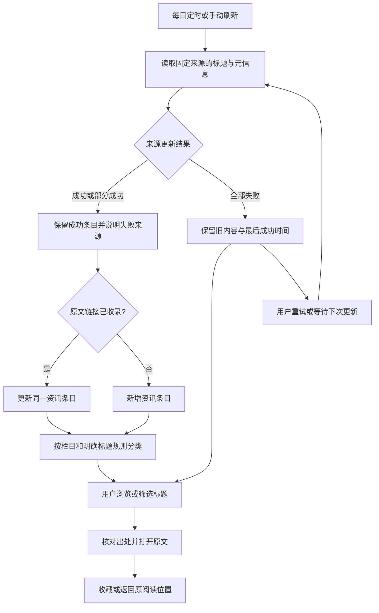

# 全球美妆研发情报台标题版 MVP PRD

## 一、用户故事

### 1.1 用户故事

- 作为化妆品研发或产品开发从业者，我想每天集中浏览资讯标题，以便发现值得进入原站阅读的线索。
- 作为个人用户，我想按关键词、分类、地区、品类和报道日期寻找资讯，以便缩小阅读范围。
- 作为个人用户，我想查看资讯出处、可得日期和对应图片，并打开原文，以便在来源网站阅读完整内容。
- 作为个人用户，我想收藏资讯并在以后继续回看，以便保留关注线索。

### 1.2 业务问题与预期目标

本产品面向个人，解决资讯入口分散、重复访问和回看困难的问题。标题版只提供发现和跳转，不代替来源网站阅读。

本次修订依据用户在设计访谈中的明确决定：D-008 不接外部模型、不生成中文摘要；D-009 只采集标题及必要元信息；D-010 仅对相同原文链接去重；D-011 采用来源栏目与明确标题规则分类。用户随后在标题版范围修订确认中授权原位修订需求与提案。

**本次范围**：固定来源更新、原文标题与必要元信息、相同链接去重、七类分类入口、组合筛选、外链图片、出处详情、原文跳转和个人收藏。每天北京时间 07:30 更新，支持手动刷新和重试。界面以中文为主，标题保持来源语言，不额外翻译；桌面优先并适配手机。正式应用使用单人登录，不开放注册。

成功状态是：用户能从标题发现线索，核对来源并进入原文，收藏后再次打开仍能找到该条资讯。缺失信息不补造，更新失败不清空已有内容，图片失败不阻断文字与收藏。

不纳入正文采集与存储、摘要、自动翻译、模型服务、跨媒体事件归并、成分或研究阶段提炼、功效或合规结论。团队协作、会员、来源编辑后台、人工审核、导出、竞品对比、统计大屏和推送仍不在本期范围内。

## 二、核心业务流程

**现状流程**：没有现成正式产品流程。现有交互稿展示了先前较完整的情报方案，但其中摘要、多来源事件归并和产品技术信息不再属于本版要求。

**目标流程**：系统定时或按用户操作从核验通过的固定来源取得标题与必要元信息，去除相同原文链接的重复条目，按来源栏目和明确标题规则分类，随后自动进入阅读列表。用户浏览或筛选标题，查看出处并进入原文，再决定是否收藏。

资讯条目代表一条原文链接，不再代表跨媒体归并后的事件。同一链接再次收录时更新该条目的可得信息；不同链接即使标题相似或报道同一事件也分别保留。来源提供标题与元信息，收藏引用资讯条目本身而不是历史快照。

**变化与影响**：系统从内容分析收缩为标题收集，不读取正文做摘要，不使用外部模型，不建立跨来源事件关系。用户仍通过统一入口阅读标题、筛选和收藏。外部网站无需为本项目修改，但具体接入必须符合其使用条件；候选网站名单不等于已接入或已授权。

## 三、功能需求

### 3.1 固定来源更新与链接去重

#### 3.1.1 功能说明

为个人用户自动汇集固定来源的资讯标题，承接从更新触发到条目可读的流程。用户不必逐条录入，也不增加人工审核负担。

**业务规则**：

- 只接入经可用性和使用条件核验的固定来源，不开放来源新增、编辑或删除界面。
- 每天北京时间 07:30 更新一次，支持手动刷新及失败后重试。手动更新不改变每日更新约定。
- 采集范围限于标题、来源、原文链接、能取得的报道日期，以及允许使用的图片外链和归属说明；不采集或保存文章正文，不生成摘要或翻译。
- 缺少可用标题或原文链接的内容不能形成可供跳转的资讯条目；其它元信息缺失不补造。
- 相同原文链接只保留一个条目。同一链接的新标题或可靠元信息更新原条目；不同链接分别保留，不依据标题相似度合并事件。
- 成功条目自动可读；来源失败不覆盖上次成功内容，不清空收藏，不冒充更新成功。

#### 3.1.2 交互逻辑

**业务状态与流转**：

- 待更新：等待每日触发或用户操作；受理后进入更新中。用户仍能阅读已有条目。
- 更新中：系统处理固定来源；完成后进入成功、部分成功或失败。页面给出进度，重复操作不制造重复条目。
- 成功：本次可用来源处理完成，新增或已更新条目可读；没有新增或改动时说明本次无新增。下一次定时或手动操作可重新发起更新。
- 部分成功：部分来源提供可用条目，另有来源失败；保留成功与历史条目，显示失败范围和可说明原因，允许重试。
- 失败：本次未取得成功更新结果；保持历史内容及最后成功时间。用户可重试，或等待下次更新。
- 可读条目：具有有效标题及原文链接的条目自动进入阅读列表；后续同链接更新不改变收藏关系。原文不可用时仍保留最后可用的标题与元信息供回看。

**页面与操作映射**：

- 用户能查看本次更新结果、最后成功时间、失败来源及手动刷新入口。
- 更新时不遮断已有条目；无新增、首次暂无条目和更新失败分别反馈。
- 同一链接重复收录后列表和收藏均只有同一条目；多家媒体的不同链接不隐藏为同一个事件。

#### 3.1.3 异常处理

| 异常场景 | 触发条件 | 系统处理方式 | 用户提示 |
|---|---|---|---|
| 部分来源失败 | 有来源失败，其余来源取得有效条目 | 保留成功和历史内容；可重试，不重复收录已有链接 | 标明受影响来源、可说明原因和重试入口 |
| 全部更新失败 | 本轮没有成功结果 | 保留历史内容及原成功时间，等待重试或下次更新 | 本次更新未完成，已有内容仍可阅读 |
| 条目信息不足 | 不能取得有效标题或原文链接 | 不创建无法使用的条目，保留本轮异常说明；既有条目不受影响 | 提示来源内容未能完整读取，不伪造标题或链接 |
| 重复触发 | 更新中再次操作 | 保持处理状态，不制造重复条目 | 显示正在更新，完成后可查看结果 |
| 来源受限 | 登录、付费、访问条件或使用许可不满足 | 不绕过限制，不假称完整覆盖；保留其它可用结果 | 说明该来源不可用及可说明原因 |

#### 3.1.4 原型

- 原型入口：[现有交互稿](<prototype.html>)；仅本地保留，不随 Git 提交。
- 演示范围：旧稿可参考刷新、空内容和失败提示；标题采集和相同链接去重没有在旧稿中真实实现。
- 已确认结论：本版标题与元信息范围、每日更新及链接去重由访谈确认，不从旧稿的事件或摘要演示反推。
- 未覆盖范围：真实接入、定时更新、链接去重和来源许可尚需正式实现与验证；旧稿中的跨来源归并不是本版验收要求。

### 3.2 标题浏览、分类与组合筛选

#### 3.2.1 功能说明

提供研发导向的标题导航。保留新品发布、趋势洞察、新原料、研发技术、包装与剂型、OEM／ODM（代工生产与设计制造）、法规与合规七类入口，帮助个人缩小阅读范围。

**业务规则**：

- 只使用来源栏目和标题中的明确词语形成分类、地区或品类信息，不读取正文、不使用模型判断。
- 无法确定分类的条目标为未分类，并可在“全部”中阅读。地区、品类未知时标为未披露，不因来源网站所在国家就推断产品市场。
- 搜索作用于标题和必要元信息；分类、地区、品类和报道日期共同限制结果。没有正文或摘要的搜索能力。
- 按该条原文披露的报道日期排序和筛选；未知日期不以收录或刷新时间补充，不宣称命中确定的报道日期范围。此规则替代原跨来源事件的最早报道口径。
- 图片通过来源链接直接展示，平台只保留地址和出处，不下载、转存、内嵌或代理图片。图片须与条目对应，且允许该用途。
- 来源图片不可用时保留文字、原文入口和收藏，不绕过防盗链，也不用无关图片代替。
- 桌面优先、手机可操作；查看详情再返回时保留查询条件和阅读位置。

#### 3.2.2 交互逻辑

**业务状态与流转**：本功能不改变资讯条目或收藏状态。分类、搜索和筛选只改变当前可见范围，不删除条目。

**页面与操作映射**：

- 标题卡展示原文标题、来源、可得报道日期、可确定分类和允许显示的图片；不设置摘要占位。
- 用户可从七类入口或“全部”浏览，组合使用搜索与筛选；无匹配时保留条件并提供清除入口。
- 未分类条目不会因为缺少属性而从“全部”消失。缺少某一筛选属性时，不伪称满足该属性条件。
- 图片加载失败只影响图片区域；用户仍能打开出处或收藏。
- 搜索、筛选、详情和收藏可用键盘完成，手机布局不依赖缩小整张桌面页面。

#### 3.2.3 异常处理

| 异常场景 | 触发条件 | 系统处理方式 | 用户提示 |
|---|---|---|---|
| 无匹配结果 | 条件没有命中条目 | 保留条件和已有数据，可调整或清除 | 当前条件下无结果 |
| 未分类或未披露 | 标题与栏目不足以确定属性 | 不强行补全；仍保留在“全部” | 显示未分类或未披露 |
| 日期未知 | 来源未提供可确定的报道日期 | 不以刷新、收录或上市时间替代 | 报道日期未披露 |
| 图片外链失败 | 地址失效、来源限制或网络不可用 | 降级为文字阅读，不转存兜底 | 图片暂不可用，可查看原文 |

#### 3.2.4 原型

- 原型入口：[现有交互稿](<prototype.html>)；仅本地保留，不随 Git 提交。
- 演示范围：沿用配色、布局、导航、响应式和图片外链交互作为视觉参考；旧稿中的摘要文案不属于本版目标。
- 已确认结论：用户在 D-001 选择沿用当前原型视觉，在 D-009、D-011 确认元信息与分类边界；不是对标题版完整页面的最终验收。
- 未覆盖范围：原标题版列表、未分类规则和真实源数据尚待设计与实现验证；本次不修改旧交互稿。

### 3.3 出处详情与原文导航

#### 3.3.1 功能说明

让用户核对标题来自哪里，再进入原站阅读全文。详情承载出处和元信息，不再承载摘要或产品技术拆解。

**业务规则**：

- 详情展示标题、来源、原文入口、可取得的报道日期、分类信息及允许使用的外链图片。
- 不提炼或新增成分、功效、研究阶段、首次上市、当地上市及发布性质等产品技术结论。不将报道日期解释为上市日期。
- 标题保持来源语言；不生成中文摘要，不配置外部模型，不提供自动翻译或原文全文。
- 原文入口对应当前条目自身的来源链接，不将搜索页、平台首页或另一个标题伪装成原文章。
- 来源不可用时保留最后可用标题与元信息，按实际已知情况提示；不能仅因来源列表暂未出现某条目就推定原文永久失效。

#### 3.3.2 交互逻辑

**业务状态与流转**：打开详情或原文不改变条目状态。详情展示最后可用元信息，收藏关系按 3.4 处理。

**页面与操作映射**：

- 用户打开条目查看出处与元信息，点击原文入口进入对应来源页面阅读完整内容。
- 返回本站时仍可继续浏览、筛选或收藏；关闭详情恢复原阅读位置。
- 详情不再显示空的摘要、成分、证据阶段或上市时间区块，也不把标题复述为系统摘要。

#### 3.3.3 异常处理

| 异常场景 | 触发条件 | 系统处理方式 | 用户提示 |
|---|---|---|---|
| 原文不可访问 | 来源页面失败或受限 | 不绕过限制，保留标题与收藏；用户可稍后再试 | 如已知则说明访问异常，不承诺本站可阅读全文 |
| 元信息缺失 | 日期、地区、品类或图片未提供 | 只展示已有信息，明确缺失，不读取正文补全 | 未披露或不展示该可选内容 |
| 同事件多家报道 | 标题类似但原文链接不同 | 保持独立条目，不生成跨媒体合并详情 | 分别显示各自标题与出处 |

#### 3.3.4 原型

- 原型入口：[现有交互稿](<prototype.html>)；仅本地保留，不随 Git 提交。
- 演示范围：仅参考详情侧栏、关闭返回和原文导航的位置；旧稿摘要、产品信息及多来源区块不是本版要求。
- 已确认结论：标题与必要元信息导航由 D-008、D-009 及范围修订确认；跨来源归并按 D-010 移出本期。
- 未覆盖范围：标题版详情未在旧稿重新实现，正式原文访问与元信息完整性仍需验证。

### 3.4 个人收藏与元信息更新

#### 3.4.1 功能说明

保留个人想继续阅读的资讯链接。收藏跟随同一条目的标题和元信息更新，而不是保存文章正文或独立历史快照。

**业务规则**：

- 同一条目只有一份个人收藏关系；再次打开应用后仍保留。
- 相同原文链接的标题或元信息更新时，收藏继续引用同一条目；不同原文链接不因标题相似而共享收藏。
- 原文不可用时保留最后可用的标题、链接和已得元信息，不自动移除收藏；不承诺保存原文或图片。
- 取消收藏不删除资讯；保存失败保持上次成功状态，不假报成功。

#### 3.4.2 交互逻辑

**业务状态与流转**：

- 未收藏：用户收藏可读条目，成功后进入已收藏；失败保持未收藏，提供可见原因。
- 已收藏：可回看或取消；同链接元信息成功更新后显示更新内容。取消成功进入未收藏，不删除条目。
- 已收藏且来源不可用：继续保留最后可用元信息及收藏，允许回看、打开原链接或取消；可用信息恢复后仍是同一条目，不产生重复收藏。

**页面与操作映射**：

- 列表、详情和收藏入口显示一致状态；收藏结果不依赖图片加载成功。
- 收藏为空时提供返回“全部”阅读的入口；不将空收藏误报为资讯库为空。
- 取消后普通列表仍可阅读同一条目，重新打开应用仍反映最后成功操作。

#### 3.4.3 异常处理

| 异常场景 | 触发条件 | 系统处理方式 | 用户提示 |
|---|---|---|---|
| 收藏或取消失败 | 操作结果未保存 | 保持上次成功状态，允许重试 | 操作未保存及可说明原因 |
| 重复收藏 | 对同条目重复发起收藏 | 不生成重复关系 | 显示已收藏 |
| 来源或图片失效 | 已收藏条目外部内容不可用 | 保留标题和已得元信息，不下载正文或转存图片 | 标明已知的不可用范围 |
| 元信息更新 | 同链接取得可靠更新 | 更新同条目，收藏关系保持 | 显示更新后的标题与日期说明 |

#### 3.4.4 原型

- 原型入口：[现有交互稿](<prototype.html>)；仅本地保留，不随 Git 提交。
- 演示范围：可参考收藏、取消和错误反馈；旧稿的示例数据与浏览器保存不代表正式收藏能力。
- 已确认结论：收藏跟随条目、取消不删条目和失败不覆盖成功状态继续保留；标题版只保存引用及元信息，不保存正文。
- 未覆盖范围：正式应用的持久保存、单人访问控制及真实来源更新尚待实现。

## 四、非功能需求

### 4.1 性能要求

- 接口响应时间：不设置未经评估的数值承诺；搜索、详情和收藏不得因后台更新而持续不可用。
- 并发用户数：个人单人使用，不承诺多租户或团队容量。
- 数据量边界：以选定固定来源的真实条目规模验证，列表采用可继续阅读的分批结果；不虚构覆盖量或采集成功率。

### 4.2 安全需求

- 权限设计：正式版只允许个人登录，不开放注册、团队或管理员后台。
- 权限校验：未登录者不得浏览个人资讯与收藏、触发更新或操作收藏；已登录用户不获得来源编辑或内容审核能力。
- 数据安全：只采集允许使用的标题与元信息，不获取全文；外链图片仍遵守来源条件，不绕过登录、付费、访问限制或防盗链。

### 4.3 操作日志记录

用户可见更新时间、更新失败范围和收藏结果，不新增用户行为追踪或审核日志后台。

| 操作 | 是否记录日志 | 记录信息 |
|---|---|---|
| 定时更新、刷新与重试 | 是，仅用户可见结果 | 最后成功时间、本轮结果、失败来源和可说明原因 |
| 收藏与取消 | 是，仅用户可见结果 | 当前实际收藏状态及保存失败原因 |
| 浏览、搜索与原文跳转 | 否 | 不新增个人行为追踪 |

## 五、测试建议

| 场景 | 前置条件 | 操作 | 预期结果 |
|---|---|---|---|
| 个人使用闭环 | 有有效标题与原文链接 | 登录、浏览、筛选、查看出处、进入原文、收藏并再次打开 | 信息可追溯，原文可导航，收藏仍保留 |
| 标题采集边界 | 来源同时提供正文与摘要 | 执行更新，检查展示与保留内容 | 只保留标题及已确认元信息，不采集正文或生成摘要，不调用模型 |
| 相同链接去重 | 同链接重复出现或标题更新 | 多次更新后查看列表及收藏 | 仍为同一条目，更新可靠元信息，不重复收藏 |
| 跨媒体不合并 | 不同链接报道同一事件 | 更新并浏览 | 分别保留标题和出处，不建立事件合并结果 |
| 七类与未分类 | 栏目或标题能分类，也有无法判断的条目 | 切换七类并查看“全部” | 规则命中正常展示，未分类在“全部”可读 |
| 地区品类不推断 | 网站所在国家与报道对象不同或信息不足 | 按地区、品类筛选 | 只依明确栏目或标题，不以网站所在地补造市场 |
| 日期边界 | 有报道日期、缺日期及转载日期各类条目 | 排序并筛选 | 使用各条原文披露日期，未知不伪造成新报道，不推导上市日期 |
| 组合条件与返回 | 已搜索筛选并滚动 | 打开详情后关闭，清除条件 | 条件交集有效，返回位置保持，清除后恢复结果 |
| 更新部分失败 | 有成功来源和失败来源 | 刷新并重试 | 保留成功和旧条目，失败范围可见，不重复收录 |
| 全部失败或无新增 | 存在历史条目 | 分别触发失败、成功但无变化 | 不清空旧数据，不冒充成功时间，区分失败与无新增 |
| 图片外链与失败 | 有允许使用的图链及失效图链 | 查看列表、详情并收藏 | 浏览器直接加载来源，失败可见，文字和收藏不受阻，不转存兜底 |
| 详情范围 | 当前标题版条目 | 查看出处详情 | 没有摘要、成分、证据阶段或上市信息提炼，原文入口对应当前链接 |
| 收藏与元信息更新 | 已收藏同链接条目 | 更新标题、重开、取消或模拟失败 | 状态一致且持久，更新跟随，取消不删条目，失败不假报成功 |
| 访问保护 | 未登录和已登录两种状态 | 浏览及触发更新、收藏 | 未登录被拒绝，登录后仅有个人已批准操作 |
| 原型边界 | 打开旧交互稿 | 对照本版需求 | 旧稿仅作视觉参考，摘要和事件演示不算本版功能证明 |
| 手机与键盘 | 窄屏或键盘操作 | 完成筛选、出处详情、原文和收藏 | 焦点清楚，控件可操作，不遮挡内容，返回位置保持 |

本产品尚无生产链路，“沿用既有业务回归”不适用。以上为后续验收建议，不代表标题版已开发或实测通过。

## 六、待确认问题

无新增产品阻塞问题。具体固定来源的可用性和许可须在接入前核验；技术设计仍在逐项确认。现有原型没有在本轮修改，标题版真实数据和页面效果仍需后续验证，这些事实不改变已经批准的产品范围。
